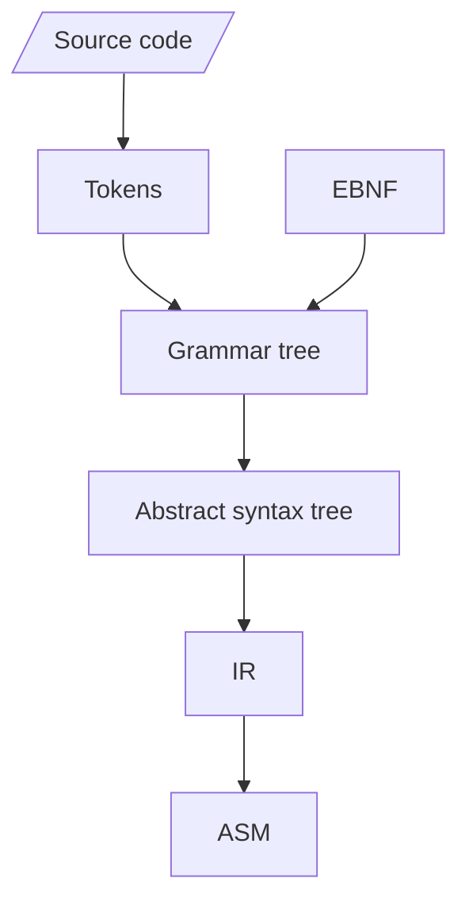
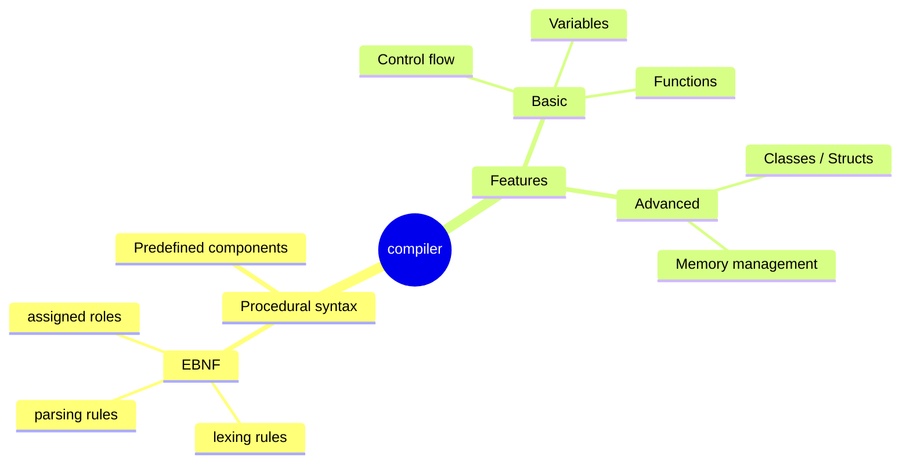

# Compiler

A final project for the sixth year of [PTI](https://www.pti.be/)\
It's a compiler that allows the user to define the syntax using EBNF syntax. This ofcourse is not that useful but it is very interesting,

## General workings


## General idea


# How to use
## Install
Cloning the repository
```bash
git clone https://github.com/abelvandenbussche/compiler
cd compiler/software
```
In the [software](software/) directory:\
Build
```bash
cargo build
```
Run tests
```bash
cargo test
```
