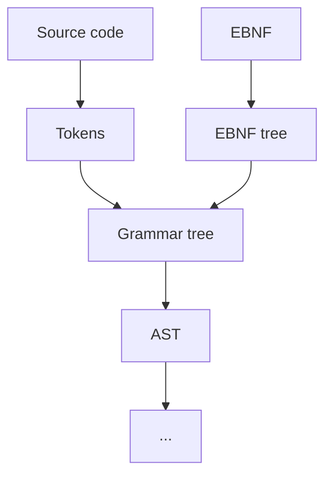

# Dynamic language syntax
The language could have non-rigid rules that can be changed by the user.
The user could edit the language rules in a single or even multiple ebnf files.

We could demand that the user define say a `program` that could be the root of the program syntax.

# Possible implementation


Where the only constant would be a EBNF user defined `program`
The `program` would be the root of the grammar tree

# EBNF example
Example of what the user could write where the program is a one or more statements and a statement is one of multiple things eg. variable declaration or if statement
```EBNF
program = { statement }
statement = ... | ... | ...
```
